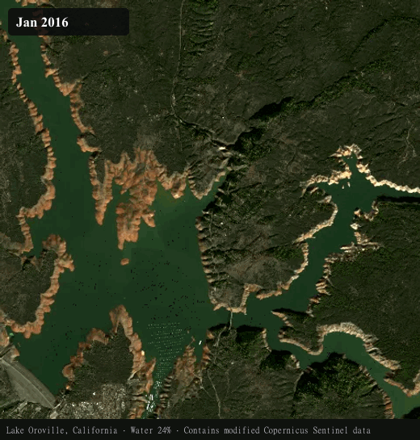

# SatLapse

**Watch any place on Earth change.** Draw an area on a map, pull its full satellite history, replay how it changed, get flagged changes with confidence levels, and (optionally) analyse it with AI. Free, open source, and it runs entirely in your browser: no server, no account, no API keys.

**Live:** https://satlapse.ashtonwilliamallen.com · [Methodology](https://satlapse.ashtonwilliamallen.com/methodology/) · [Security & privacy](https://satlapse.ashtonwilliamallen.com/security/)



## Features

- **Any area, full history.** Search or pan, draw a polygon or rectangle (up to 100 km²), and SatLapse fetches every clear Sentinel-2 pass since 2015, or back to **1984 with Landsat**, harmonised so charts stay comparable.
- **Cloud screening that matters.** Cloud cover is measured over *your polygon*, from per-pixel classification layers rather than whole-tile metadata. Choose every clear scene, or the best per month or quarter.
- **High-res aerial imagery (US).** NAIP aerial photos at 0.3–1 m, every 2–3 years, alongside the 10 m satellite timeline, plus a high-res imagery basemap.
- **Replay & compare.** A timelapse player with a time-proportional timeline, true colour / vegetation / water / built-up views, change highlights, a synced chart, and a before/after swipe for any two dates.
- **Seasonal-aware change detection.** Each scene is compared with *the same time of year* in earlier years, so harvests, snow and reservoir cycles don't raise false alarms. Every flagged change carries a confidence level and a plain-language explanation.
- **Projects.** Group areas, keep Markdown notes, pin annotations to a place and date ("new structure appears here"), and see everything on one timeline.
- **Export & share.** GIF and MP4 timelapses with attribution burned in. Self-contained HTML/PDF reports where every finding cites its scene date, sensor and source ID. Portable project files. Share links that carry only area outlines.
- **Optional AI analysis**, in three layers of trust:
  - *Copy to AI*: paste the project into any chat, no key needed.
  - *Local models* via Ollama.
  - *Your own key* for Anthropic, OpenAI, Google Gemini or OpenRouter. The model requests specific images through tools, and anything it drafts is saved only if you approve it.
- **Tracking.** Each time you open the app it checks your areas for new imagery and badges what's new.
- **Private by design.** Strict Content Security Policy, no analytics, data stays in your browser. Keys are memory-only by default. [How to verify →](https://satlapse.ashtonwilliamallen.com/security/)


## How it works

```
Browser
 ├─ STAC search ──► Element84 Earth Search, Microsoft Planetary Computer
 ├─ HTTP range reads of Cloud Optimized GeoTIFFs (only the pixels over your area)
 ├─ Web Worker engine: screen clouds → sample → mosaic → indices → change → events
 ├─ IndexedDB: projects, imagery, stats, notes, annotations
 └─ (optional) AI provider APIs, called directly with your key or a local Ollama
```

The engine in `src/core` has no browser dependencies. It runs in a Web Worker today and under Node (`scripts/sync-node.ts`), so a future server can reuse it unchanged. See [HANDOFF.md](HANDOFF.md) for the full architecture, decisions and measured performance, and [SPIKE.md](SPIKE.md) for the feasibility work behind each data source.

## Run locally

Requires Node 20+.

```bash
git clone https://github.com/ashtonwallen/OSINT-SatLapse-Satellite-Image-Tool.git
cd OSINT-SatLapse-Satellite-Image-Tool
npm install
npm run dev
```

Open http://localhost:5173. Other commands:

| Command | What it does |
|---|---|
| `npm test` | Unit tests |
| `npm run build` | Production build into `dist/` (with the strict CSP) |
| `npm run preview` | Serve `dist/` locally with the CSP header |
| `npm run csp:sync` | Update `vercel.json` after changing `src/config/csp.ts` |
| `npx jiti scripts/sync-node.ts …` | Run a backfill under Node and write a project file (see the script header) |
| `npx jiti scripts/media.ts` | Regenerate `docs/replay.gif` and `public/og.png` from the example |

Using a local AI model: install [Ollama](https://ollama.com), pull a vision model (`ollama pull qwen2.5vl`), and start it with your app's origin allowed:

```bash
OLLAMA_ORIGINS=http://localhost:5173 ollama serve
```

## Deploy

SatLapse is a static site. `npm run build` outputs `dist/`, which runs on any static host with no code changes.

- **Vercel** (configured): import the repo. `vercel.json` sets the build, clean URLs, caching and security headers (including the CSP). Add your domain under *Settings → Domains*.
- **Cloudflare Pages / Netlify:** build command `npm run build`, output `dist`. The generated `dist/_headers` applies the CSP.
- **GitHub Pages or any sub-path:** `BASE_PATH=/your-repo/ npm run build`.

Configuration lives in `src/config/`:
- `brand.ts`: name, domain, colours, repo URL, alerts waitlist URL.
- `app.ts`: limits; override at build time with `VITE_MAX_AREA_KM2`.
- `csp.ts`: allowed hosts.
- `entitlements.ts`: free/paid feature gates.

## Data & attribution

Contains modified Copernicus Sentinel data. Landsat imagery courtesy of the U.S. Geological Survey. NAIP imagery from the USDA Farm Production and Conservation Business Center (public domain). Basemap © OpenFreeMap, OpenMapTiles, OpenStreetMap contributors; high-res basemap from USGS The National Map. Place search by Photon (komoot), data © OpenStreetMap contributors. Exports carry the required credits automatically.

## Contributing & licence

Contributions welcome. See [CONTRIBUTING.md](CONTRIBUTING.md). Licensed under [AGPL-3.0](LICENSE).
