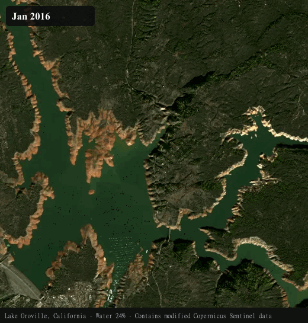

# SatLapse

Draw an area on a map, pull its full satellite history and replay how it
changed. It runs in your browser with no server, account or API keys. It also
ships as an MCP server, so AI agents can use the same engine.

**Live:** <https://satlapse.ashtonwilliamallen.com> ·
[Methodology](https://satlapse.ashtonwilliamallen.com/methodology/) ·
[Security](https://satlapse.ashtonwilliamallen.com/security/)



## Features

- **Full imagery history** for any area up to 100 km²: Sentinel-2 since 2015,
  Landsat since 1984, and NAIP aerial photos in the US
- **Cloud screening** measured over your area, not the whole tile
- **Timelapse replay** with vegetation, water and built-up views, plus a
  before/after swipe
- **Change detection** that compares the same season across years, with a
  confidence level on each flagged change
- **Projects** with notes, pinned annotations, and GIF, MP4, HTML and PDF
  exports
- **Optional AI analysis:** copy the project into any chat, run a local Ollama
  model, or use your own key
- **Private:** strict CSP, no analytics, and data stays in your browser

## Run locally

Node 20+:

```bash
npm install
npm run dev     # http://localhost:5173
npm test
npm run build   # static site in dist/
```

## MCP server

Agents can find a place, create an area, download its history, read flagged
changes and write findings:

```bash
claude mcp add --scope user satlapse -- npm run --silent --prefix "$(pwd)" mcp
```

Other clients: add a stdio server that runs `npm run --silent --prefix <repo> mcp`.
Projects save to `~/.satlapse/mcp` and open in the web app. No keys are needed.

## Deploy

It's a static site. `vercel.json` is set up for Vercel, and for other hosts
the build is `npm run build` with output in `dist`. Settings live in
`src/config/`.

## Attribution

Contains modified Copernicus Sentinel data. Landsat imagery courtesy of USGS.
NAIP imagery from the USDA. Map data © OpenFreeMap, OpenMapTiles and
OpenStreetMap contributors. Place search by Photon. Exports include the
required credits.

[AGPL-3.0](LICENSE).
